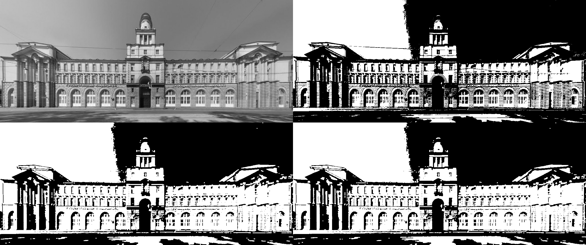
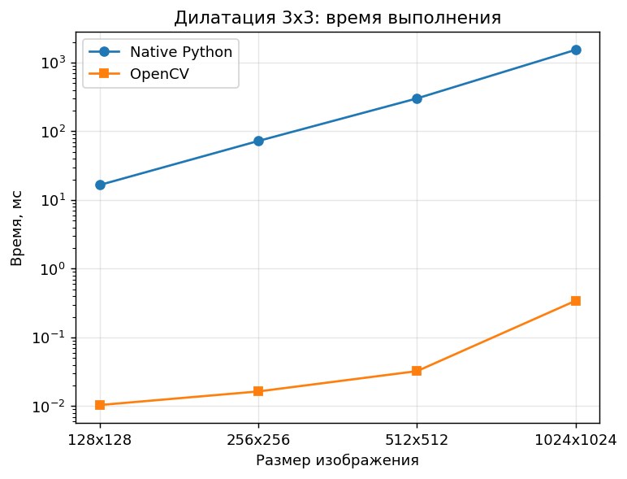

# ЛР1. Дилатация бинарного изображения (вариант 6)

**Цель работы:** научиться реализовывать один из простых алгоритмов обработки изображений.

**Задание:** реализовать дилатацию с примитивом 3×3 в двух вариантах — встроенной функцией библиотеки (OpenCV) и нативно на Python — и сравнить их быстродействие. Бинаризацию по условию варианта можно не реализовывать вручную.

## 1. Теоретическая база

Дилатация (наращивание) — базовая операция математической морфологии. Для бинарного изображения `A` и структурного элемента (примитива) `B`:

```
A ⊕ B = { z | (B)z ∩ A ≠ ∅ }
```

Примитив прикладывается центром к каждому пикселю изображения. Если под примитивом оказался хотя бы один белый пиксель, то центральный пиксель результата становится белым. Для изображения со значениями 0 и 255 это эквивалентно взятию максимума по окрестности:

```
dst(x, y) = max src(x + i, y + j),   i, j ∈ {-1, 0, 1}
```

Эффект дилатации:

- белые объекты расширяются на 1 пиксель в каждую сторону;
- мелкие чёрные дыры и разрывы в контурах закрываются;
- близко расположенные объекты сливаются;
- шум в виде одиночных белых точек усиливается: точка превращается в квадрат 3×3.

Крайние случаи: полностью белое изображение остаётся белым, полностью чёрное — чёрным, так как максимум по любой окрестности не меняется.

Дилатация применяется к бинарному изображению, поэтому исходное изображение сначала бинаризуется. В работе для этого используется метод Оцу из библиотеки OpenCV.

## 2. Описание разработанной системы

Программа написана на Python с использованием библиотек OpenCV, NumPy и Matplotlib. Весь код находится в файле [`dilation.py`](dilation.py).

| Функция | Назначение |
|---|---|
| `dilate_native` | дилатация 3×3 на чистом Python |
| `dilate_opencv` | дилатация 3×3 через `cv2.dilate` |
| `binarize` | бинаризация методом Оцу (`cv2.threshold`) |
| `test_image` | генерация тестового изображения (текст, фигуры, шум) |
| `measure` | замер времени выполнения (лучшее из нескольких запусков) |

Библиотека используется только для чтения, бинаризации и сохранения изображений. Сам алгоритм дилатации в `dilate_native` написан вручную.

**Порядок работы программы:**

1. Загрузка изображения в оттенках серого (или генерация тестового изображения).
2. Бинаризация.
3. Дилатация двумя способами.
4. Попиксельная проверка совпадения результатов (`np.array_equal`).
5. Замер времени на изображениях от 128×128 до 1024×1024 и построение графика.

**Нативный алгоритм:**

```
для каждого пикселя (x, y):
    взять до 3 соседних строк (y-1, y, y+1)
    в каждой строке взять до 3 элементов (x-1, x, x+1)
    dst[y][x] = максимум среди этих элементов
```

Пиксели за границей изображения не учитываются. Так же по умолчанию ведёт себя `cv2.dilate`, поэтому результаты двух реализаций совпадают полностью. Сложность алгоритма — `O(W · H · 9)`, то есть линейная по числу пикселей.

**Запуск:**

```bash
pip install opencv-python numpy matplotlib
python dilation.py lab1.jpg     # своё изображение
python dilation.py              # сгенерированное тестовое изображение
```

Результаты сохраняются в папку `results/`.

## 3. Результаты работы и тестирования системы

Исходное изображение — [`lab1.jpg`](lab1.jpg), 1170×490 пикселей.

Верхний ряд: изображение в оттенках серого и результат бинаризации. Нижний ряд: нативная дилатация и дилатация OpenCV.



После дилатации белые области расширились: тёмные оконные проёмы и тонкие чёрные линии (провода, швы между камнями) стали тоньше или исчезли, мелкие чёрные детали на фасаде закрылись. Количество белых пикселей выросло с 239 859 до 300 381. Результаты двух реализаций совпадают попиксельно.

**Быстродействие.** Замеры выполнены на сгенерированных тестовых изображениях четырёх размеров, для каждого взято лучшее время из нескольких запусков.

| Размер | Native Python, мс | OpenCV, мс | Ускорение |
|---|---|---|---|
| 128×128 | 16.6 | 0.0104 | 1592× |
| 256×256 | 72.4 | 0.0164 | 4414× |
| 512×512 | 301.3 | 0.0324 | 9301× |
| 1024×1024 | 1535.2 | 0.3430 | 4476× |



**Закономерности:**

- Время обеих реализаций растёт примерно пропорционально числу пикселей: при увеличении стороны изображения в 2 раза время увеличивается примерно в 4 раза.
- OpenCV быстрее на три порядка. Причины: код на C++ компилируется, а не интерпретируется; используются SIMD-инструкции; квадратный примитив раскладывается на два одномерных прохода — по строкам и по столбцам.
- На маленьких изображениях ускорение меньше, так как заметную долю времени OpenCV занимают накладные расходы на вызов функции.

## 4. Выводы по работе

В ходе работы реализована дилатация бинарного изображения примитивом 3×3 двумя способами. Нативная реализация на Python даёт результат, полностью совпадающий с `cv2.dilate`, но работает в тысячи раз медленнее. Написать алгоритм вручную полезно для понимания принципа его работы, однако на практике следует использовать оптимизированные библиотечные функции.

## 5. Использованные источники

1. Гонсалес Р., Вудс Р. Цифровая обработка изображений. — М.: Техносфера, 2012. — Гл. 9 «Морфологическая обработка изображений».
2. OpenCV documentation: Eroding and Dilating — https://docs.opencv.org/4.x/db/df6/tutorial_erosion_dilatation.html
3. OpenCV documentation: `cv::dilate` — https://docs.opencv.org/4.x/d4/d86/group__imgproc__filter.html
